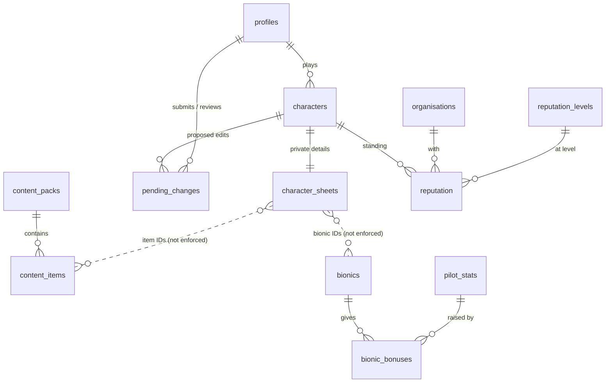

# Database sketch

**Status: draft for review.** Nothing here is built yet. Once it's agreed, it gets turned into SQL migrations in `supabase/migrations/`.

## The big picture

The tables fall into four groups:

1. **People:** `profiles`
2. **Characters:** `characters` (the public card), `character_sheets` (the private details) and `pending_changes` (edits waiting for a GM, which also form the history)
3. **Game content:** `content_packs` and `content_items` (LANCER data and homebrew LCPs), plus `pilot_stats`, `bionics` and `bionic_bonuses` (the site's own content)
4. **GM-only:** `organisations`, `reputation_levels` and `reputation`



The dotted lines are links the database can't check: they're IDs stored inside the sheet's JSON.

**Why a character is split in two:** database rules (RLS) decide which *rows* someone can read, not which *columns*. Everyone can read the public card, so anything private has to live in a different table, which only the character's player and GMs can read.

## Words used below

- **Player, GM, owner:** the three roles. **GM+** means GMs and owners.
- **The character's player:** the person who plays that character. (Not the same as the Owner role.)
- **Logged in:** the whole site needs a login. Logged-out visitors only see the login page.

## Tables

### `profiles`: one row per person

| Column | Type | Notes |
|---|---|---|
| `id` | user ID | Primary key. The same ID Supabase Auth gives the user. |
| `display_name` | text | Copied from Discord at sign-up. |
| `role` | player / gm / owner | Starts as player. |
| `created_at` | date-time | |

- **See:** every logged-in user (so the site can show who plays which character).
- **Add:** nobody through the site. A profile is created automatically at first login.
- **Change:** nobody through the site. Roles are set by hand in the Supabase dashboard.
- **Delete:** nobody through the site.

### `characters`: the public card

| Column | Type | Notes |
|---|---|---|
| `id` | number (automatic) | Used in URLs, e.g. `/characters/42`. |
| `player_id` | → `profiles` | Who plays this character. |
| `status` | pending / approved / dead | Decides which tab it shows in. |
| `pilot_name` | text | |
| `callsign` | text | |
| `age`, `gender`, `sexuality` | text | Free text, so answers like "34 (subjective)" work. |
| `height`, `weight`, `eye_colour`, `hair_colour` | text | Free text, so any units work. |
| `appearance` | text | The appearance description. |
| `pilot_image` | text | Path to the appearance image in Storage. |
| `personality` | text | |
| `traits` | text | Narrative: what the character is good at. |
| `mechs` | JSON list | Public info for each mech: `id`, `name`, `appearance`, `image`, `manufacturer_id`. The `id` matches the mech in the private sheet. The site checks `manufacturer_id` against the `XXXX-XXXX-XXXX` format, and warns if another mech already uses it. |
| `created_at`, `approved_at`, `died_at` | date-time | |
| `updated_at` | date-time | Kept up to date automatically. |

- **See:** every logged-in user, in every status.
- **Add:**
  - A player can add one for themselves, with status pending, but only if they don't already have a pending or approved character.
  - GM+ can add any, including their own characters straight as approved.
- **Change:**
  - The player can change their own character only while it's pending, and it has to stay pending, so they can't approve themselves.
  - GM+ can change any character at any time.
- **Delete:** the player can delete their own while it's pending (withdrawing a new character). GM+ can delete any.

### `character_sheets`: the private details

| Column | Type | Notes |
|---|---|---|
| `character_id` | → `characters` | Primary key: exactly one sheet per character. |
| `sheet` | JSON | Everything the player can propose. See the example below. |
| `mod_points` | number | The pilot's mod-point total. Not part of any pending change, so after approval only GMs can change it. |
| `review_note` | text | The GM's note on a new character that isn't approved yet. |
| `updated_at` | date-time | Kept up to date automatically. |

- **See:** the character's player and GM+.
- **Add / change:** the player while the character is pending, and GM+ at any time.
- **Delete:** deleted along with its character.

While a new character is pending, the player can write anything in here, mod points included. That's fine, because a GM reviews all of it before approving. Once a character is approved, the player can't write to `characters` or `character_sheets` at all. Every change goes through `pending_changes`.

Example `sheet`. The IDs are real `lancer-data` IDs, but the shape will change as the site gets built (real loadouts have mounts, for example):

```json
{
  "licence_level": 2,
  "licences": [{ "id": "mf_blackbeard", "rank": 2 }],
  "mech_skills": { "hull": 1, "agility": 0, "systems": 1, "engineering": 0 },
  "pilot_stats": { "physicality": 3, "dexterity": 2, "perception": 2, "acuity": 1, "tech_fluency": 2 },
  "talents": [{ "id": "t_ace", "rank": 1 }],
  "core_bonuses": ["cb_auto_stabilizing_hardpoints"],
  "pilot_gear": ["pg_light_a_c"],
  "bionics": [4],
  "mechs": [
    {
      "id": "m1",
      "frame": "mf_blackbeard",
      "mounts": [
        { "type": "Flex", "weapons": ["mw_assault_rifle"] },
        { "type": "Main", "weapons": [] },
        { "type": "Heavy", "weapons": [] }
      ],
      "systems": ["ms_custom_paint_job"]
    }
  ],
  "manna": 150,
  "backstory": "..."
}
```

Notes on the example:
- `pilot_stats` holds the starting values. The site adds bionic bonuses on top when it shows the sheet.
- The mounts come from the frame: Blackbeard has Flex, Main and Heavy. The site checks that each weapon fits its mount. Some talents and core bonuses add extra mounts.
- System points, pilot HP and mech stats are calculated from the frame and the chosen items, not stored.
### `pending_changes`: edits to approved characters, and their history

| Column | Type | Notes |
|---|---|---|
| `id` | number (automatic) | |
| `character_id` | → `characters` | |
| `submitted_by` | → `profiles` | |
| `proposed_public` | JSON | New values for the public card's fields. |
| `proposed_sheet` | JSON | The full proposed sheet. |
| `based_on` | date-time | When the character last changed before this edit started. Used to catch overwrites. |
| `status` | pending / approved / rejected | |
| `review_reason` | text | Required when rejected. |
| `reviewed_by` | → `profiles` | |
| `reviewed_at` | date-time | |
| `created_at` | date-time | |

The database allows **at most one pending change per character**.

- **See:** the character's player and GM+.
- **Add:** the character's player, for their own approved character.
- **Change:**
  - The player can edit their change while it's still pending.
  - GM+ can only change it to rejected, with a reason. Approving goes through `approve_change` (see below).
- **Delete:** the player can delete their change while it's pending (withdrawing it). Reviewed changes are never deleted, because they're the history.

### `content_packs` and `content_items`: LANCER data and homebrew LCPs

`content_packs`:

| Column | Type | Notes |
|---|---|---|
| `id` | number (automatic) | |
| `name`, `version` | text | From the pack's `lcp_manifest.json`. |
| `manifest` | JSON | The whole manifest. |
| `enabled` | yes / no | "Removing" a pack switches this off. |
| `imported_by` | → `profiles` | |
| `imported_at` | date-time | |

`content_items`:

| Column | Type | Notes |
|---|---|---|
| `id` | text | The item's own ID, e.g. `mf_blackbeard`. Must be unique across all packs. |
| `pack_id` | → `content_packs` | |
| `kind` | text | frame, weapon, system, mod, talent, core_bonus, pilot_gear, reserve, tag and so on: whichever file the item came from. |
| `data` | JSON | The item exactly as it is in the pack. |

- **See (both tables):** every logged-in user.
- **Add / change:** owners only.
- **Delete:** nobody. Characters store item IDs inside the sheet's JSON, so the database can't tell whether an item is in use.
  - Re-importing a pack updates its items in place.
  - Switching a pack off hides its items from new choices, but characters that already use them still display properly.
- If two packs use the same item ID, the import fails with a clear message instead of quietly overwriting.

### `pilot_stats`: the custom pilot stats

| Column | Type | Notes |
|---|---|---|
| `id` | text | Short key, e.g. `tech_fluency`. Used in sheets and bonuses. |
| `name` | text | e.g. "Tech-fluency". |
| `sort_order` | number | Display order. |

It starts with five rows: physicality, dexterity, perception, acuity and tech-fluency.

- **See:** every logged-in user.
- **Add / change:** owners.
- **Delete:** nobody, because sheets refer to it. Rename a stat instead.

### `bionics` and `bionic_bonuses`

`bionics`:

| Column | Type | Notes |
|---|---|---|
| `id` | number (automatic) | |
| `name`, `description` | text | |
| `manna_cost` | number, 0 or more | |
| `mod_point_cost` | number, 0 or more | |
| `retired` | yes / no | Used instead of deleting. Hides the bionic from new choices. |

`bionic_bonuses`, with one row for each stat a bionic raises:

| Column | Type | Notes |
|---|---|---|
| `bionic_id` | → `bionics` | |
| `stat_id` | → `pilot_stats` | The database rejects a stat that doesn't exist. |
| `amount` | number | |

- **See:** every logged-in user. It's a catalogue that players pick from. Which bionics a character *has* stays private, in their sheet.
- **Add / change:** owners. Owners can also delete a bonus row.
- **Delete a bionic:** nobody. Retire it instead.

### `organisations`, `reputation_levels` and `reputation`: GM-only

`organisations`: `id`, `name`, `description`.

`reputation_levels`: `id`, `name` (e.g. Hostile, Neutral, Allied; the real names aren't decided yet), and `sort_order` (lowest to highest).

`reputation`, with one row per character per organisation:

| Column | Type | Notes |
|---|---|---|
| `character_id` | → `characters` | |
| `organisation_id` | → `organisations` | |
| `level_id` | → `reputation_levels` | |
| `updated_by` | → `profiles` | |
| `updated_at` | date-time | |

- **See:** GM+ only, for all three tables. Players can't see any of it, even for their own character.
- **Add / change:** owners manage organisations and level names. GM+ set reputation.
- **Delete:** owners can delete an organisation, which also deletes its reputation rows.

## Database functions

These are the two all-or-nothing actions:

1. **`approve_change(change_id)`**, for GM+ only:
   1. Checks that the caller is a GM or owner, and that the change is still pending.
   2. Checks that the character hasn't changed since `based_on`. If it has, it refuses. The GM then rejects the change, and the player resubmits on top of the latest version. This stops a GM's direct edit from being silently overwritten.
   3. Copies `proposed_public` into `characters`, and `proposed_sheet` into `character_sheets`.
   4. Marks the change approved, with who approved it and when.
2. **`mark_dead(character_id)`**, for the character's player or GM+:
   1. Checks the caller.
   2. Changes the character from approved to dead and sets `died_at`. It refuses if the character is already dead.
   3. Deletes any pending change for that character.

There are also two small helpers:

- **`is_gm()`** answers "is the current user a GM or owner?". Every GM rule uses it.
- **A sign-up trigger** runs automatically at someone's first login and creates their profile as a player.

`updated_at` is kept current by `moddatetime`, a Postgres extension that Supabase already includes, so no code is needed for it.

## Images (Supabase Storage)

- There's one bucket, `character-images`. It's not public: only logged-in users can view the images.
- Players upload into a folder named after their own user ID. GM+ can upload anywhere.
- There's a size limit (say 5 MB), and only image file types are allowed.
- Shortcut: replaced images stay in storage. Clean them up later if the 1 GB free storage gets tight.

## How things flow

- **Sign-up:** someone logs in with Discord, and a player profile is created. You promote GMs and owners in the dashboard.
- **New character:**
  1. The player creates a pending character (the card and the sheet).
  2. Everyone sees its card in the Pending tab, and the player can keep editing it.
  3. A GM approves it by setting the status to approved and filling in the mod points. That's a normal edit, so no function is needed.
  4. If it isn't ready, the GM writes a `review_note` and the player fixes it.
- **Editing an approved character:**
  1. The editor starts from the current version.
  2. Saving creates a pending change.
  3. The player can edit or withdraw it until a GM reviews it, and can't start another one in the meantime.
- **GM review:**
  - The page shows the difference between the current and proposed versions.
  - Approve runs `approve_change`.
  - Reject needs a reason, and the player then submits a new change.
- **Installing a bionic:** this is just an edit. The player adds the bionic's ID and subtracts its manna cost in the same change. The GM checks the cost, the mod points, and that any swap is "similar".
- **Death:** the player confirms, or a GM clicks, and `mark_dead` runs. The character moves to the Dead tab, and the player can make a new one (a flash clone).
- **GMs' own characters:** GMs create them as approved and edit them directly.
- **LCP import:**
  1. An owner picks an `.lcp` file.
  2. The browser unzips it and reads the manifest.
  3. The site saves the pack, then adds or updates its items.

## Choices to check

These are assumptions made while drafting. Each one is easy to change now and harder later.

1. **Manufacturer IDs are only soft-unique.** They're made of letters and digits. The site warns about duplicates, but the database doesn't block them, because the IDs live inside a JSON list. If they ever must be strictly unique, mechs would need their own table.
2. **New characters don't use `pending_changes`.** The player edits the pending character directly. A GM leaves a `review_note` instead of formally rejecting it, so there's no history for new-character reviews.
3. **Withdrawing a pending change deletes it.** It isn't kept in the history.
4. **The organisations list is hidden from players too**, not just reputation.
5. **The bionics and stats catalogue is visible to every logged-in user**, so players can choose from it. What a character has stays private.
6. **Packs, items, bionics and stats are never deleted.** They're switched off or retired instead.
7. **The whole site needs a login.**
8. **A pending change stores a full copy of the proposed sheet**, not just the differences. The GM page works out the differences when it shows them.
9. **The Discord name is copied once, at sign-up.** It doesn't follow later name changes.

## Not included (add later if wanted)

- Reputation history (only the current level is kept).
- A log of GMs' direct edits.
- Notifications, such as a Discord ping when something is waiting for review.
- Weapon mods and LANCER reserves (not on the field list).

## When this becomes SQL

- Every table has RLS switched on and explicit grants to logged-in users only. Logged-out (`anon`) users get nothing.
- Every `→` column gets an index.
- Functions that skip RLS check the caller themselves.
- Each rule gets tested by logging in as a player and trying to break it.
